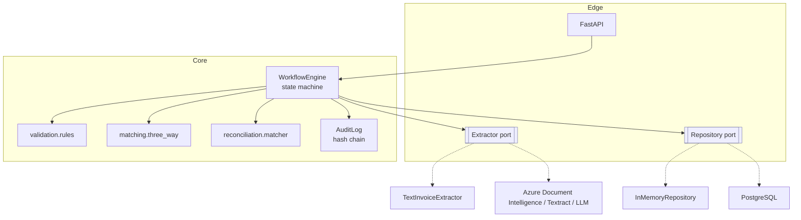

# Architecture

## Context

Accounts payable in a mid-sized company: hundreds of supplier invoices a month arrive as PDFs and scans. Staff re-key them, chase approvals by email and reconcile payments in spreadsheets. The costly failures are **paying a fraudster**, **paying twice** and **paying for goods never received**.

## Principles

1. **Straight-through only when provably safe.** Automation earns trust by being boring.
2. **Humans decide anything uncertain**, with reasons, and their decisions are recorded.
3. **Every state change is auditable and tamper-evident.**
4. **The core is pure and synchronous**; I/O lives at the edges behind ports.

## Components

## State machine

Transitions are a table (`workflow/engine.py::ALLOWED`). `REJECTED` and `PAID` are terminal. `NEEDS_REVIEW` is the single human gate; it can only be left by a named reviewer with a note.

## Confidence and the human gate

Every extracted field carries a confidence. Values **read** from the document score high; values **inferred** (e.g. total = subtotal + VAT when the total line is missing) score low. The minimum across critical fields gates straight-through processing. This keeps a cheap deterministic extractor safe, and lets an ML extractor be introduced without changing the workflow.

## Reconciliation algorithm

| Pass | Rule | Certainty |
|---|---|---|
| 1 | Exact amount **and** normalised invoice number in payment reference | 1.0 |
| 2 | Exact amount **and** counterparty ≥ 0.8 similar to vendor (legal suffixes stripped), unique best | ≈ similarity |
| 3 | One payment = sum of 2–6 open invoices of one vendor, **unique** combination | 0.9 |

Pass 3 is bounded subset-sum; ambiguous combinations are deliberately left for a human.

## Data and integrity

- `source_ref` unique → idempotent ingestion.
- Partial unique index on `(vendor_id, normalised invoice_number)` excluding rejected → duplicates are impossible even under concurrent ingestion.
- `audit_log` is append-only at the permission level and chained by SHA-256.
- `version` column supports optimistic locking when two reviewers open the same invoice.

## Scaling

Ingestion is CPU-light; extraction is the expensive step. In production, `POST /invoices` stores the document and enqueues it; workers run the same `WorkflowEngine.ingest`, which is idempotent, so queue redeliveries are harmless.
